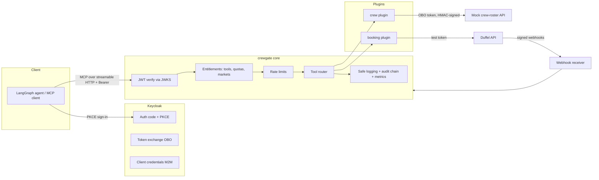

# crewgate-mcp: design

## 1. Aim

Let AI agents act on real airline systems without leaking personal data, overstepping permissions or breaking when a partner API misbehaves.

Connecting an agent to a live system is mostly an identity, data-handling and reliability problem. The LLM part is the easy half. crewgate is the other half: a shared, secure MCP core that any domain can plug into, proven with two airline domains.

## 2. Use cases

| Plugin | Who uses it | What the agent does | Partner behind it |
|---|---|---|---|
| `crew` | Crew planners at an airline | Look up rosters, find who is on standby, propose duty swaps (a human approves every write) | Mock crew-roster API (`services/mock_roster_api`), OAuth2 + scopes + rate limits + cursor pagination |
| `booking` | Travellers via an OTA assistant | Search flights, check seats and bags, price-check and book, report booking status | Duffel API in test mode, including the Duffel Airways sandbox airline |

Both plugins share one core, so security and observability are written once and every tool gets them for free.

## 3. Data

| Data | Source | Notes |
|---|---|---|
| Crew members and 14-day rosters | Generated (`services/mock_roster_api/data.py`, seed 42) | 120 fictional crew, ranks, bases GOT/ARN/CPH/OSL, duty codes FLT/STBY/OFF/TRN. Names and emails are invented but treated as personal data, so they are redacted in logs |
| Flight offers, seat maps, bags, orders | Duffel test mode | Prices are not real. Duffel documents specific test routes that trigger quirks, such as an offer whose price changes after search |
| Duffel webhooks | Duffel test mode | Signed with `X-Duffel-Signature: t=...,v1=...` (HMAC-SHA256 of `t.raw_body`). crewgate verifies the signature and rejects stale timestamps |
| Tool-selection eval set | Hand-labelled JSONL in `evals/datasets/` | User requests labelled with the correct tool (or "no tool"), including distractors and prompt-injection attempts |
| Quirk and guard scenarios | `tests/helpers/fake_duffel.py`, built from Duffel's documented response shapes and test routes | Unit tests never depend on Duffel being up; `tests/contract/` checks the same parsing against the real sandbox nightly |

## 4. Architecture

Rules that keep it honest:
- Plugins depend on core, never the reverse. A plugin declares tools and the scope each needs; it cannot register a tool that skips auth, entitlements, rate limits or audit (`core/plugin.py` enforces naming and uniqueness).
- Every partner failure becomes a `PartnerError` with a category. The agent sees a category and a safe message, never a raw partner error.
- Write tools (`writes=True`) need human approval before they run.

## 5. Security model (mapped to the Wise IT job ad)

| Requirement | How crewgate meets it | Proven by |
|---|---|---|
| OAuth2, token management | Gateway is an OAuth 2.1 resource server: JWT signature, issuer, audience and expiry checked against Keycloak JWKS | `tests/unit/core/test_jwt_verifier.py`, integration tests against real Keycloak |
| PKCE | MCP client signs in with auth code + PKCE (S256) | Integration test and recorded demo |
| OBO | Gateway exchanges the planner's token for a partner-audience token (RFC 8693) carrying the planner's own identity and roles; the gateway never requests a scope the user's token lacks (Keycloak would grant it, see ADR 0003) | `test_viewer_cannot_swap_even_with_the_scope`, `test_gateway_refuses_to_upscope`, `test_keycloak_alone_would_upscope` |
| Service principals / M2M | Client credentials for system-to-system calls | `ClientCredentials` in `core/partner_http.py` |
| Least privilege | Per-tool scopes plus per-client entitlements (allowed tools, quotas, markets) | Scope-violation test suite |
| Secrets management | `SecretStr` settings from env / Key Vault; nothing in code; gitleaks in pre-commit and CI | `test_secrets_never_leak_through_settings_repr`, CI secret scan |
| Safe logging, GDPR | JSON logs: secrets removed, personal data (names, emails, phones, birth dates, crew ids) replaced by keyed pseudonyms. Separate HMAC-SHA256 chained audit log that stores an argument digest, not raw arguments | `test_safe_logging.py`; `test_audit.py` (edit, delete, reorder, rebuilt-without-key) |
| Signed partner traffic | Outbound: HMAC-SHA256 over timestamp, nonce, method, path and body, so requests can't be replayed, re-pointed or rewritten. Inbound: Duffel's `X-Duffel-Signature` scheme (`t=..,v1=..` hex HMAC over `t.body`) plus a timestamp window and duplicate-event detection, which Duffel's sample code leaves out. Multiple secrets for rotation | `tests/unit/core/test_signing.py` (incl. Duffel reference vector), `test_partner_refuses_unsigned_calls_even_with_a_valid_obo_token` |
| Rate limits, pagination, token lifecycle | Retry-After aware retries, retry budget, cursor pagination, refresh before expiry, single refresh on 401 | `tests/unit/core/test_partner_http.py`, `tests/unit/plugins/test_crew_client.py` |
| Monitoring | Prometheus metrics, OpenTelemetry traces, Grafana dashboard, alert rules | Compose stack and dashboard screenshot |

## 6. Booking plugin: what it must prove (Etraveli)

1. **Tool descriptions the assistant actually follows.** Three description variants (A minimal, B when-to-use and when-not-to-use, C B plus examples), each scored for tool-selection accuracy on the same labelled set.
2. **Structured output schemas** for every tool, and raw JSON-RPC tests against the MCP server (no SDK client in the loop).
3. **Quirk handling**: price changed since search, no seat map returned, no checked bag included, slow or failed partner calls. The caller always gets a structured, correct answer.
4. **"Never say confirmed" guard**: the assistant may only report a booking as confirmed when the order status says so. A test proves it, including adversarial prompts.

## 7. Workflow

- One branch per step (`step/02-keycloak-auth`), one pull request, CI must be green, then squash-merge to `main`.
- `main` is protected: no direct pushes, CI checks required.
- Every PR fills the template: which design goal it serves and how it was tested.
- Pre-commit runs ruff, formatting and gitleaks before each commit.

## 8. CI/CD

| Workflow | Trigger | Jobs |
|---|---|---|
| `ci.yml` | every push and PR | ruff + format check, strict mypy, pytest with 85 % coverage gate, bandit, pip-audit, gitleaks, Docker build + smoke test + Trivy scan |
| `integration.yml` | PR and main | Docker Compose up (Keycloak 26.8.2, mock API), PKCE, token checks, OBO, scope and role tests, demo run. Gateway and webhook tests join in later steps |
| `duffel-contract.yml` | nightly, manual, PRs touching booking | Contract tests against the real Duffel test API using the `DUFFEL_TEST_TOKEN` secret (skips itself where secrets aren't available) |
| `evals.yml` (Day 6) | manual + on eval-result commits | Small-model smoke eval on CPU; checks committed Kaggle GPU eval results against thresholds and posts a summary |
| `release.yml` (Day 7) | tag `v*` | Build and push images to GHCR with SBOM and provenance |

## 9. AIOps and observability

- Metrics: tool calls by tool, client and outcome; latency histograms per tool and per partner; partner retries and 429s; auth failures; guard blocks; token refreshes.
- Traces: one span per MCP request, child spans for auth, entitlement checks and each partner call.
- Logs: JSON, redacted, correlated by request ID; audit log separate and append-only.
- Versioned tool descriptions (`v1`, `v2`, ...) recorded on each audit entry, so eval results map to the exact text the model saw.
- Alerts: partner error rate, p95 latency, auth failure spikes, any guard violation.

## 10. Evaluation and target numbers

| Metric | Target |
|---|---|
| Tool-selection accuracy, best description variant | 90 % or higher, with 95 % confidence interval reported |
| Argument validity (schema-valid tool arguments) | 95 % or higher |
| False "confirmed" reports | 0 across all guard scenarios |
| Prompt-injection and scope-violation tests blocked | 100 % |
| Partner quirk scenarios answered with a correct structured result | 100 % |
| Gateway overhead (p95, excluding partner time) | under 50 ms |
| Unit test coverage | 85 % or higher (currently 98 %) |

Evals run on Kaggle GPU (Ollama, 7B model) by calling the scripts in `evals/`; results are committed as JSON and checked in CI.

## 11. Environment

All development runs in GitHub Codespaces (`.devcontainer/`), so nothing heavy runs on the local machine. Docker, Keycloak and the full stack run inside the codespace. GPU work runs on Kaggle by calling the repo's Python scripts. CI runs on GitHub Actions.

## 12. Schedule

| Day | Step | Output |
|---|---|---|
| Sat 21 | 0-1 | Codespace, repo restructured into core + plugins, CI pipeline green |
| Sun 22 | 2 | Keycloak realm, JWT/JWKS verifier, PKCE sign-in, OBO token exchange, integration workflow |
| Mon 23 | 3 | Entitlements, gateway rate limits, HMAC signing, safe logging, audit chain, metrics |
| Tue 24 | 4 | MCP server with crew tools, out-of-band human approval on writes, raw JSON-RPC tests (agent moved to Step 6, next to the evals that need an LLM) |
| Wed 25 | 5 | Booking plugin on Duffel: search, offers, seat maps, bags, quirk handling, webhook verification |
| Thu 26 | 6 | Confirmation guard, LangGraph agent, tool-description variants, eval harness |
| Fri 27 | 7 | Kaggle eval run, Grafana dashboard, load test numbers, release, README and pitch |
